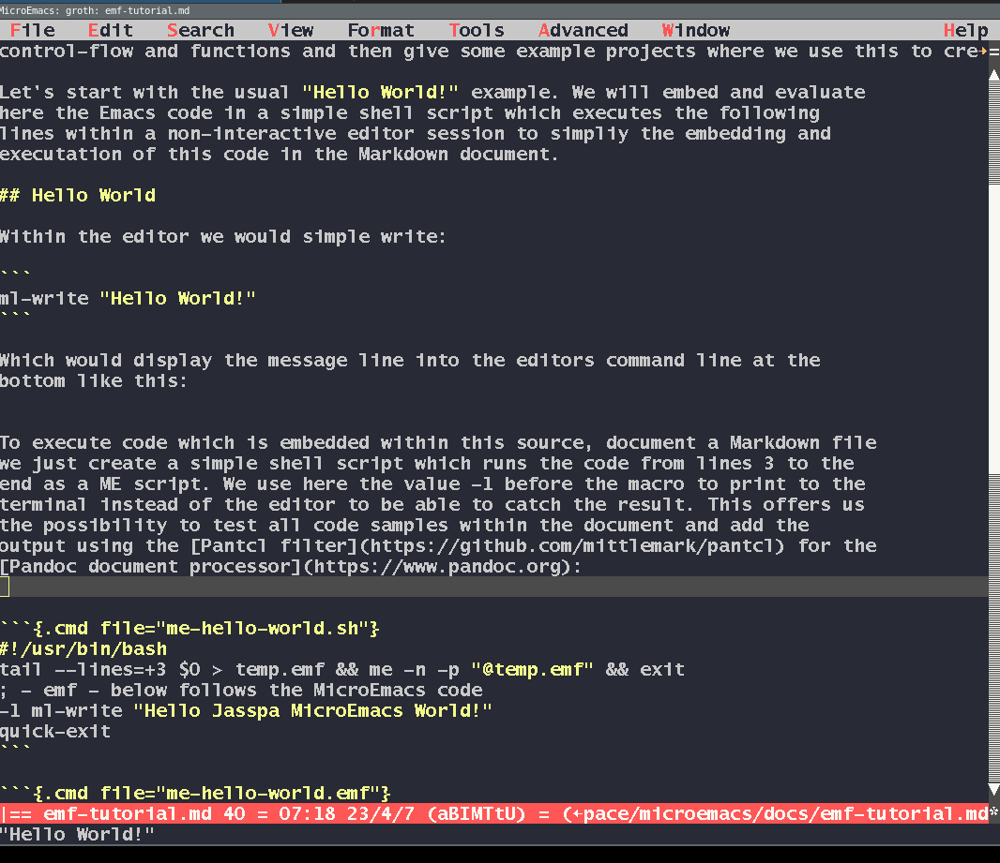

## Introduction

This is a tutorial about the [Jasspa MicroEmacs](http://www.jasspa.com)
language. We will cover the basic features of the language, variables, data
structures, control-flow and functions and then give some example projects
where we use this to create some useful extensions.

The examples are written as EMF code blocks. The document build weaves the
Markdown with `tmdoc` and converts it to HTML with `mndoc`; it does not execute
the examples. You can try a snippet by selecting it and running
`execute-region`, or by saving it in a macro file and loading that file.

## Hello World

Within the editor we would simple execute:

```emf
ml-write "Hello World!"
```

That the should display the message line into the editors command line at the
bottom like this:



You can  execute the code by pressing  `"Esc-x"`  then  writing  `"ml-write"`,
pressing  the  ENTER  key and  then  writing  the  message  `"Hello  World!"`.
Alternatively  you can write the text in the editor, marking the code line and
an empty line thereafter and then `"Esc-x"` and write `"execute-region"`.

## Variables

For more background on the variables have a look at the help page [Variables](https://www.dgroth.de/me2009/me/m4fil018.htm).

Essentially we have:

- register variables - starting with the hash mark sign __#__ there are mainly used due to the fast access speed
- system variables - starting with the dollar sign __$__ and followed uppercase letters
- editor variables - starting with the dollar sign __$__ and followed by lowercase letters
- command variables - usually starting with a dot __.__ sign to be used within macros
- global variables - usually starting with a percentage __%__ sign
- buffer variables - usually starting with a colon __:__, these variables keep information about the currently opened file

Variable values were assigned usually with the `set-variable`  command. Here an example:

```emf
; make dumping out information easier
define-macro print
    -1 ml-write @1
!emacro

print "Hello Print World!"
set-variable %test "This is a test!"
set-variable #g1 "This is a global register variable!"
print %test
print #g1
; some editor variables
print $buffer-bname
print $progname
print $version
```

Every code example in this tutorial is in its own script file, so if we would like to use
the `print` macro in the next code example this would produce an error.

```emf
print "test"
```

To use our print macro we will place this macro in our `user.emf` file which is in our jasspa home directory:

```emf
-1 ml-write $user-path
-1 ml-write $user-name
```

So as our setting show we simply write the print macro in a file `groth.emf`.
Thereafter we should be able to use the `print` function in all code-chunk
examples. For illustrative purposes we place the function in a file
`tutorial.emf` which we put in our `$user-path` and which we then just execute
like this at the beginning of our code chunk:

```emf
execute-file "tutorial.emf"
print "Hello Tutorial!"
```

Now back to variables ...

### Register variables

Global register variables start with the prefix `#g` and then a number between
1 and 9. There are used for fast access of variables values which are visible in all code regions:

```emf
execute-file "tutorial.emf"
set-variable #g1 "Value of #g1 is a string!"
set-variable #g2 "Another value!"
define-macro test-global
    print #g1
!emacro 
test-global
print #g2
```

Local variable a prefixed with `#l` and the values again from 1 to 9.

Here an example:

```emf
execute-file "tutorial.emf"
define-macro test-local
    set-variable #l1 "Local variable string!"
    print #l1
!emacro 
test-local
set-variable %test &spr "#l1 is '%s'" #l1
print %test
```

As you can see the default value for register variables is an empty string.

There are as well register variables with the prefix `#p` which means that the should be as well visible in the calling macro, so the parent macro.
Here an example:

```emf
execute-file "tutorial.emf"
define-macro child-mac
    ; set a local variable in the caller
    set-variable #p1 "Hello parent!"
!emacro
define-macro parent-mac
    child-mac
    print #l1
!emacro
parent-mac
```

This might be helpful in some situations but might as well complicate a little bit the code
understanding.

### System variables 


As told system variables start with a dollar and they keep information about
the editor and some variables which are derived from system variables. You can
display the variables using the macro "list-variables" from within the editor,
so executing `esc-x` and then writing the command. Or by using the default
key-combination `C-h v`. Here we just display a few of these variables:

```emf
execute-file "tutorial.emf"
print &sprintf "variable: $auto-time    = %s" $auto-time  
print &sprintf "variable: $buffer-bname = %s" $buffer-bname
print &sprintf "variable: $not-existing = %s" $not-existing
; load a file into MicroEmacs
find-file &cat $user-path "groth.emf"
print &sprintf "variable: $buffer-bname = %s" $buffer-bname
print &sprintf "variable: $buffer-fname = %s" $buffer-fname
; how many lines has this file
end-of-buffer ; jump to the end
print &sprintf "variable: $window-aline = %s" $window-aline

```

As you can see in the case you try to access a variable that does not exists
you get the value "ERROR" as a variable value, that can be used to check if a
variable exists. Here an example:

```emf
execute-file "tutorial.emf"
set-variable %real-var "hello"
set-variable #l2 %real-var
set-variable #l3 %dummy-var
; check if the variable has the string ERROR &seq == string equal
!if &seq #l2 "ERROR"
    print "variable %real-var does not exists!"
!else
    print "variable %real-var does exists!"
!endif
!if &seq #l3 "ERROR"
    print "variable %dummy-var does not exists!"
!else
    print "variable %dummy-var does exists!"
!endif
```


## Data structures


We have the following data structures in MicroEmacs:

- scalars
- lists

A scalar is just a single value. Per default  MicroEmacs  has only one more complex data  structure,  the list,
which is just recognized by ME if a variable  contains a list of pipe symbols.
Here an example:

```emf
execute-file "tutorial.emf"
set-variable #l1 "|this|is|a|list|"
print &lget #l1 1
print &lget #l1 2
```

As you  can  see we can  get  the  element  of a list  using  the  `&lget`
function. To work with lists we have as well the following functions:

- `&ldel list idx`  - delete an element of a list
- `&lfind list value` - find a position in a list by value
- `&linsert list index value` - insert an element at a certain position
- `&lset list index value` - set a value of a list at a certain position

```emf
execute-file "tutorial.emf"
set-variable #l1 "|this|is|a|list|"
set-variable #l1 &linsert #l1 1 "start"
print &lget #l1 1
print &lget #l1 2
```

Access and  modification  to lists is quite slow, so it is  preferred to store
not so large data in a list.

For  illustration  purpose let's create an other data  structure, a dictionary
like  structure  were we can have access using key value pairs. The  functions
starting  with the  ampersand  sign are  created  on the  C-level.  To  create
functions  on the macro  level we will  create two macros  which will handle a
dictionary not based on a list but based on data saved in a hidden buffer ":*dict*DICTNAME:"

```emf
execute-file "tutorial.emf"
define-macro dict
   set-variable #l1 &spr ":*dict*%s:" @1
   set-variable #l2 @2
   !force set-variable #l3 @3
   !if $status
     !if &not &exi &ind #l1
       set-position "\x82"
       find-buffer &mid #l1 1 -1
       buffer-mode "hide"
       !force goto-position "\x82"
     !endif
     set-variable &ind &cat #l1 #l2 &set .value #l3
   !else
     set-variable .value &ind &cat #l1 #l2
   !endif
!emacro
define-macro dict-get
    set-variable @3 &ind &spr ":*dict*%s:%s" @1 @2
!emacro

; we can now set dictionary values
dict "aa" "Cys" "Cystein"
dict "aa" "Ala" "Alanin"
; and we can retrieve these values later
dict-get "aa" "Cys" #g0
print #g0
dict-get "aa" "Ala" #g0
print #g0
```

We need to give a  variable  name where we would like to store  these  values.
This  code  was  kindly  provided  by  Steven  Phillips  as an  example  for a
dictionary  implementation.  As you can see ME is  quite  flexible  and can be
extended  creating  custom  macros. We will  discuss  this topic later in more
detail.

## Operators and Functions

Operators and functions are created on the C-level they can be broadly divided
into the type of data they handle:

- boolean data
- math data
- string string data

You find out what functions are available by having a look at the help page of
the  Macro  Language  Glossary.  To get  this  help  page  use the menu  entry
"Help-General-Help" and then browse to "Macro-Dev".

### Numerical functions

Here are some examples on how to use the language glossary:

```emf
execute-file "tutorial.emf"
set-variable #l0 -12
set-variable #l1 &abs #l0   ; absolute value
print #l0
print #l1
print &add #l1 1            ; add 1
print &div #l1 4            ; divide by four
set-variable #l2 &inc #l1 1 ; increment variable
print #l2
```

### String functions

Now a few examples for working with strings:

```emf
execute-file "tutorial.emf"
set-variable #l0 "Hello Murks"
print &rep #l0 "Murks" "World!"      ; replace a string
print &cat &cat "Hello " "World" "!" ; concatenate a string
print &rig "Hello World!" 6          ; right characters
print &lef "Hello World!" 6          ; left characters
print &mid "Hello World!" 6 8        ; middle characters
print &slo "Hello World!"            ; lower case
print &sup "Hello World!"            ; upper case
print &len "Hello World!"            ; length of string
print &trb " Hello World!  "         ; trim string - remove whitespaces
```

You can combine these functions in different ways:

```emf
execute-file "tutorial.emf"
set-variable #l0 &rep &trb &cat " Hello " "Murks    " "Murks" "World!"
print #l0
```

In the example above we  concatenate  first the strings " Hello" and "Murks  "
using the function  `&cat`, then we remove the  whitespaces at the beginning
and the end using  `&trb` and thereafter we do the  replacement of the the
last two strings. You could translate this like so:

`rep(trim(cat(" Hello ", "Murks    ")), "Murks", "World!")`

### UTF-8 strings

MicroEmacs supports UTF-8 natively and keeps the encoding per buffer. It
auto-detects file encodings; use `mec -E utf-8 file.txt` to force a buffer to
UTF-8 when needed. See [UTF-8 Encoding](../doc/utf8-encoding.md) for details.

The traditional string functions such as `&len` and `&mid` count bytes. The
`&u` variants count valid UTF-8 sequences as characters; their positions are
1-based. These functions count encoded characters, not user-perceived
graphemes, so a base letter followed by a combining mark may count as two.

```emf
execute-file "tutorial.emf"
set-variable #l0 "αβγ"
print &len #l0          ; 6 bytes in UTF-8
print &ulen #l0         ; 3 characters
print &uleft #l0 2      ; αβ
print &umid #l0 2 1     ; β
```

### Operators

First again let's start with numerical issues:

```emf
execute-file "tutorial.emf"
print &equal 3 3   ; equal ? 1 true
print &equal 3 4   ;         0 false
print &greater 4 3 ; greater 4 > 3
print &greater 3 4 ; greater 3 > 4
print &less    3 4 ; less  r 3 < 4

```

Now a few string operators/functions:

```emf
execute-file "tutorial.emf"
print &seq "Hello" "World!"     ; should return 0 / false
print &seq "Hello" "Hello"      ; should return 1 / true
print &seq "HELLO" &sup "Hello" ; should return 1 / true
print &isequal "HELLO" "HeLLo"  ; case insensitive comparison
print &isin "HE" "Hello"        ; case insensitive check
print &sin  "HE" "Hello"        ; case   sensitive check
```

There are as well  functions,  operators  working  on  strings  using  regular
expressions:

```emf
execute-file "tutorial.emf"
print &xse "Hello World!" "H.+!"   ; 1 true
print &xse "file.cpp" ".+\\.cp?p?"
print &xse "file.c"   ".+\\.cp?p?"
print &xse "file.h"   ".+\\.cp?p?" ; 0 false
```

These examples  should give you an idea how to manipulate  numbers and strings
using the MicroEmacs macro language.

## Control-Flow

MicroEmacs has as well the usual control  structures:

- `!if`, `!elif`, `!else`, `!endif`
- `!while` with `!done`
- `!repeat` with `!done` or `!until`
- `!break` and `!continue`

But first let's look at some
methods  to  express  current  date and time  which we might  later use for an
example where we greet the user:

```emf
execute-file "tutorial.emf"
print $time
print &cat "Year:  " &mid $time 0 4
print &cat "Month: " &mid $time 7 2 
print &sprintf "Month: %02d" &mid $time 7 2 ; leading zero
print &cat "Day:   " &mid $time 9 2  
print &cat "Wday:  " &mid $time 11 1 ; 0=Sum
; lets create a list and extract the three day abbreviations
set-variable %weekdays "|NULL|Sun|Mon|Tue|Wed|Thu|Fri|Sat|"
print &cat "Wday:  " &lget %weekdays &mid $time 11 1
print &sprintf "Hour:   %02d" &mid $time 12 2 
print &sprintf  "Min:    %02d" &mid $time 14 2 
```

Let us now  evaluate  what hour it is in the  morning  and then greet the user
with the right choice!

```emf
execute-file "tutorial.emf"
set-variable #l0 &mid $time 12 2  ; the current hour
print &sprintf "Current hour is: %02d" #l0
!if &gre #l0 4 &and &less #l0 11  ; from 5 to ten
    print "Good Morning!"
!elif &gre #l0 10 &and &less #l0 15
    print "Good Day!"
!elif &gre #l0 14 &and &less #l0 18    
    print "Good Afternoon!"
!elif &gre #l0 17 &and &less #l0 23    
    print "Good Evening!"
!else
    print "Good Night!!"
!endif
print &lget "|01|02|03|04|" 2
```

So an "if" statement  starts with the  expression  `!if` an "else if" with the
expression  `!elif`  and the "else" with the  expression  `!else` and if or an
if/elif/else  block must be finished with an else. The MicroEmacs  editor will
automatically help you by indenting the blocks.

Instead of these  complex  and  conditions  we could as well use the  `&lfind`
function  which  returns 0 if the  element is not in the list, here an example
for the code above  using this  feature. As in the case an element is not in a
list the return value is zero, we can directly use it in an if condition.

```emf
execute-file "tutorial.emf"
; the  current  hour with leading zero if early in the morning
set-variable  #l0  &sprintf  "%02d" &mid $time 12 2  
print #l0
print &lfind "|05|06|07|08|09|10|" #l0 ; checking &lfind
!if &lfind "|05|06|07|08|09|10|" #l0 
    print "Good Morning!"
!elif &lfind "|11|12|13|14|" #l0
    print "Good Day!"
!elif &lfind "|15|16|17|" #l0
    print "Good Afternoon!"
!elif &lfind "|18|19|20|21|22|" #l0
    print "Good Evening!"
!else
    print "Good Night!!"
!endif
```

Using `&lfind` might be in some cases easier to read and to understand.

Let's continue with loops. ME provides `!while` and `!repeat`, but no
C-style `for` loop. A counting loop can be written with `!while`:

```emf
execute-file "tutorial.emf"
set-variable #l0 0  ; initialization
!while &less #l0 8  ; condition 
    set-variable #l0 &inc #l0 1 ; increment
    print #l0
!done
```    

To skip the rest of a loop we have the `!continue`  directive.  Let's modify the
example  above and only show even  numbers. We can do this by using the `&mod`
function/operator.

```emf
execute-file "tutorial.emf"
set-variable #l0 0
!while &less #l0 8 
    set-variable #l0 &inc #l0 1 
    !if &mod #l0 2 ; skip odd numbers
        !continue
    !endif  
    print #l0
!done
```    

The `!repeat` directive has no condition at its start, so use `!break` to end
it explicitly, or `!until` to test a condition at the end of each iteration.
Here is an example using `!break`:

```emf
execute-file "tutorial.emf"
set-variable #l0 0
!repeat
    set-variable #l0 &inc #l0 1
    print #l0
    !if &gre #l0 7
        !break
    !endif    
!done
```

Alternatively, `!until` checks a condition at the end of each `!repeat`
iteration:

```emf
execute-file "tutorial.emf"
set-variable #l0 0
!repeat
    set-variable #l0 &inc #l0 1
    print #l0
!until &gre #l0 7
```

Current versions support three levels of `!while` and `!repeat` nesting,
including combinations of the two loop types. The following examples each use
two levels and count six iterations:

```emf
execute-file "tutorial.emf"
set-variable #l0 0  ; outer loop
set-variable #l2 0  ; total iterations
!while &less #l0 3
    set-variable #l0 &inc #l0 1
    set-variable #l1 0  ; inner loop
    !while &less #l1 2
        set-variable #l1 &inc #l1 1
        set-variable #l2 &inc #l2 1
    !done
!done
print #l2 ; 6
```

The same iteration count can be expressed with nested `!repeat` loops:

```emf
execute-file "tutorial.emf"
set-variable #l0 0  ; outer loop
set-variable #l2 0  ; total iterations
!repeat
    set-variable #l0 &inc #l0 1
    set-variable #l1 0  ; inner loop
    !repeat
        set-variable #l1 &inc #l1 1
        set-variable #l2 &inc #l2 1
    !until &gre #l1 1
!until &gre #l0 2
print #l2 ; 6
```

`!goto` and `!tgoto` are also available for jumps to labels; see the
MicroEmacs help pages for their details.

## Functions - Macros


After  discussing the basics of programming  with ME we continue with creating
macros in ME, which are like  functions, we should now discuss the following topics

- `define-macro` - define a macro/function
- `define-help` - define help for a macro/function

Functions, called as well macros in ME can not return  values.
However, you can arguments and add as well here variable  names and modify these  variables as inside of
your  function.  Here an example which squares the submitted  value and stores
the value in the given variable:

```emf
execute-file "tutorial.emf"
define-macro square-value
   set-variable @2 &mult @1 @1
!emacro
square-value 5 #l0
print #l0
```

The first  argument for a macro is always `@1`, the second `@2` and so on. So,
although  we can't  return  values  from  macros,  we can give  references  to
variables and store date there.

Macro  behavior  often is modified by preceeding the macro call with a numeric
argument, `-1 ml-write "message string"` was an example where the message goes
to the terminal but not to the editor. Let's create a root function:

```emf
execute-file "tutorial.emf"
define-macro check-num
    !if @?
        ; numeric argument given
        print &sprintf "Given: %d" @#
    !else
        print "No numeric argument given"
    !endif
!emacro
check-num
100 check-num
-5 check-num
```

For    more     information     consult    the     MicroEmacs     help    page
on "define-macro".

## Working with files/buffers

Let's  finish  for now with a macro  which  extracts  all header  line of this
document and places is them with the line number into its own file, toc.txt.

```emf
find-file emf-tutorial.md
beginning-of-buffer
-1 ml-write $buffer-bname
; let's now search for lines starting with two hashes
!force  search-forward "^##"
!while $status
    forward-char
    -1 ml-write &sprintf "line: %03d %s" $window-line @wl 
    !force search-forward "^##"
!done
```

Let's extend this a little bit so that we write this into a file "toc.txt".

```emf
find-file "emf-tutorial.md"
find-file "toc.txt"
beginning-of-buffer
set-mark
end-of-buffer
exchange-point-and-mark
kill-region
find-buffer "emf-tutorial.md"
beginning-of-buffer
; let's now search for lines starting with two hashes
!force search-forward "^##"
!while $status
    forward-char
    -1 ml-write &sprintf "line: %03d %s" $window-line @wl 
    set-variable #l0 &sprintf "line: %03d %s\n" $window-line @wl 
    find-buffer "toc.txt"
    insert-string #l0
    find-buffer "emf-tutorial.md"
    !force search-forward "^##"
!done
```

## Develop your own macros

After understanding a few basic you might like to create your own macros.

First  you  could add these  macros  into your  `USERNAME.emf`  file  which is
usually  within  your ME home  folder.  Let's  open this file and add a simple
macro  which  deletes all line with a certain  string  within  these line. You
would like to use this macro every time you have such formats to convert.

Here an example file:

```
some text
delete me because I am not required
some text with other lines
delete me but with some other text
some text within other lines
```

So let's  create a simple macro to delete all lines within the current  buffer
which have the text "delete me" at the beginning of the lines. We start with a
simple message in the macro. Open your  `USERNAME.emf` file and write down the
following text:


```emf
define-macro remove-delete-me
    1000 ml-write "Macro is here"
!emacro
```

Highlight  the three  macro  lines and  execute  the command  `execute-region`
(Esc-x   execute-region).   If  you  did   this   you  now   have  a   command
`remove-delete-me`  which you can  execute by again  pressing  `Esc-x` and the
writing  `remove-delete-me`  - you can use tab completion, so writing  remoTAB
should be sufficient. Afterward you see the message line in your editor.

You can now modify the code,  re-mark and again use `execute-region` to update
the macro code. Let's change the macro try it again out.

```emf
define-macro remove-delete-me
    1000 ml-write "Macro is here again!!"
!emacro
```

That way you can stepwise extend the macro. BTW: I did this all here directly
within a Markdown document, so it must be not an EMF file, but the final macro
should  be then  written  then in such an EMF file.  Placing  the  macro  into
`USERNAME.emf` ensures that it is loaded at every ME start.

Here would be the final macro:

```emf
define-macro remove-delete-me
    ; stepwise debugging
    set-variable $debug 2
    set-alpha-mark "p"
    !force  search-forward "^delete me"
    !while $status
        kill-line
        !force search-forward "^delete.me"
    !done
    goto-alpha-mark "p"    
    1000 ml-write "Macro was executed!!"
    set-variable $debug 0
!emacro
```

Here some example text on which we can apply this macro:

```
hello 1
delete me 1
hello 2
delete me 1
```

We set some  debugging  variable  on top to step  through the macro code. This
helps us in  identifying  problems  in the code. We will see then that we must
jump to the beginning of the line and then the code should work:

```emf
define-macro remove-delete-me
    set-alpha-mark "p"
    !force  search-forward "^delete me"
    !while $status
        beginning-of-line
        kill-line ; cleans the line
        kill-line ; the then empty line
        !force search-forward "^delete.me"
    !done
    goto-alpha-mark "p"    
!emacro
```

Placing the course above the text which should be  manipulated  allows us then
to remove these lines.

```
<CURSOR>
hello 1
delete me 1
hello 2
delete me 2
```

After executing `remove-delete-me` we will then have this output:

```
<CURSOR>
hello 1
hello 2
```

This was a very simple  example,  but it shows you how to start  writing  your
own macros.  Consult the embedded  MicroEmacs  help pages
(Esc-?) for more  information.  

BTW: There is as well a macro recorder "Ctrl-x
(" to start the  recorder  and  "Ctrl-x )" to end a macro,  and  "Ctrl-x e" to
execute the last recorded macro.

## Formal Grammar Reference

For a formal BNF (Backus-Naur Form) grammar of the EMF macro language, see
[doc/emf-bnf.md](../doc/emf-bnf.md). The grammar specifies the complete syntax
including token types, expressions, directives, and block structure.

Key grammar rules:
- Programs are sequences of lines (blank, comment, command, directive, or label)
- Every line is self-contained (no line continuation with `\`)
- Prefix notation: functions appear before arguments (`&add 1 2`)
- All values are strings; numeric conversion happens automatically
- Comments start with `;` and extend to end of line
- Labels start with `*` at beginning of line

## Document generation

Build the tutorial HTML from this Markdown source with `make` in the `docs`
directory. The Makefile runs `tmdoc` in weave mode and then uses `mndoc` to
produce the HTML. EMF code blocks use standard Markdown fences and are not
executed as part of this build.

```
cd docs
make
```

 
